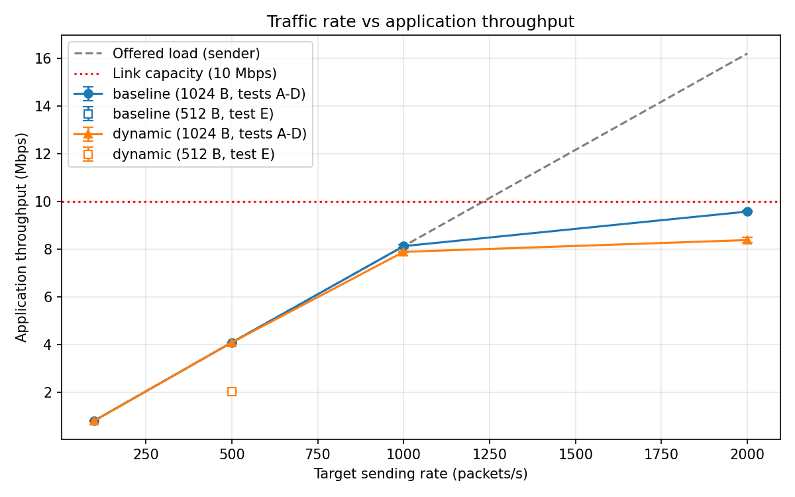
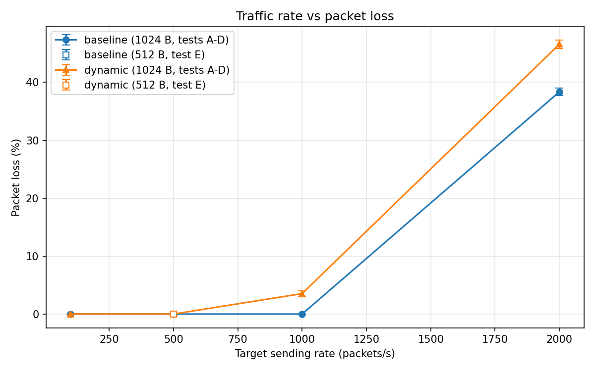
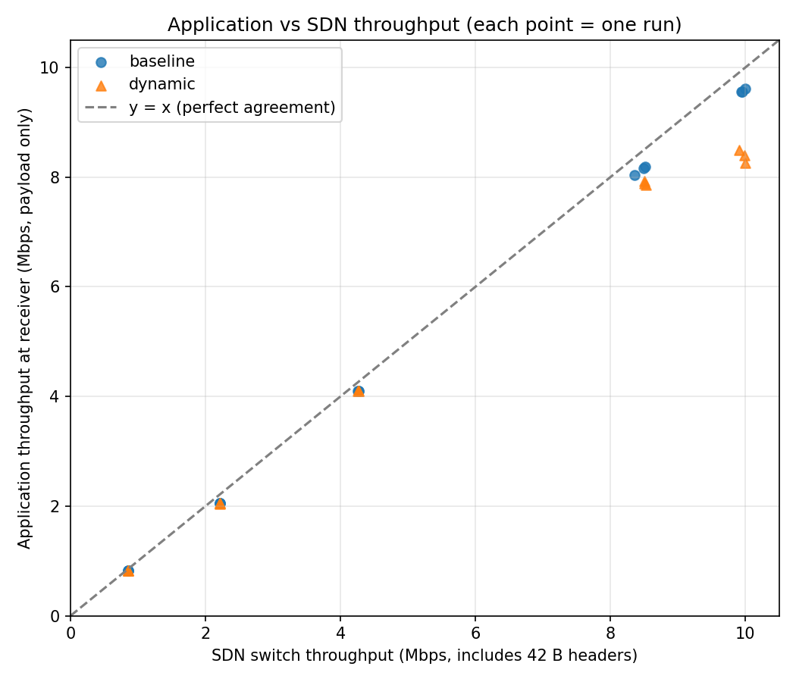
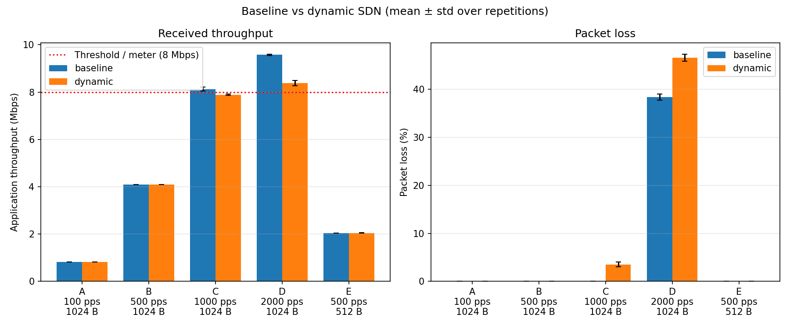

# Bandwidth Meter and Traffic Analyzer (UDP + SDN)

A UDP-based bandwidth measurement application deployed on a Mininet network controlled by a Ryu SDN controller. The project compares **application-level measurements** (what the sender and receiver count) with **SDN switch flow statistics** (what the OpenFlow switch counts) under different traffic loads, and evaluates a **dynamic SDN mode** in which the controller detects threshold violations and rate-limits the flow with an OpenFlow meter.

**Central question:** how closely do application-level UDP measurements correspond to SDN switch measurements, and how do both change under different traffic loads?

## Objectives

| Requirement | Implementation |
|---|---|
| Generate UDP measurement traffic | `sender/sender.py`: paced UDP datagrams with 10-digit sequence numbers |
| Count transmitted packets | Sender summary (`sent_packets`, `sent_bytes`) |
| Count received packets | `receiver/receiver.py`: unique, duplicate and lost datagrams |
| Calculate throughput | Sender, receiver and `analysis/analyze.py` |
| Collect SDN flow statistics | `sdn/controller.py` polls OpenFlow flow statistics every 5 s |
| Measure packet loss | Receiver plus analysis, including *where* loss happens (before the switch vs at the switch) |
| Compare application and network measurements | `analysis/analyze.py`, `application_vs_sdn.png` |
| Analyze different traffic loads | Tests A–E, 3 repetitions each, baseline and dynamic modes |

## Architecture

```
                     Ryu controller (sdn/controller.py, OpenFlow 1.3, 127.0.0.1:6653)
                       - MAC learning and forwarding
                       - dedicated UDP:5001 monitoring flow
                       - flow-statistics polling every 5 s -> results/flow_stats.csv
                       - dynamic mode: threshold detection -> OpenFlow meter
                                      |
                                      | OpenFlow 1.3
                                      |
 h1 (10.0.0.1) ---- 10 Mbps, 5 ms ---- s1 (Open vSwitch) ---- 10 Mbps, 5 ms ---- h2 (10.0.0.2)
 sender.py                                                                       receiver.py
```

| Component | File | Role |
|---|---|---|
| UDP sender | `sender/sender.py` | Sends datagrams at a target rate (pps) and size for a fixed duration |
| UDP receiver | `receiver/receiver.py` | Counts unique and duplicate datagrams, measures throughput |
| Topology | `sdn/topology.py` | Mininet network h1–s1–h2 with `TCLink` bandwidth/delay limits |
| Controller | `sdn/controller.py` | Forwarding, UDP flow monitoring, statistics export, dynamic rate limiting |
| Experiment runner | `experiments/run_experiments.py` | Builds the network, runs tests, joins app and switch data into `measurements.csv` |
| Analysis | `analysis/analyze.py` | Computes metrics, averages repetitions, produces CSVs and graphs |

### Controller flow rules

| Priority | Match | Action | Purpose |
|---|---|---|---|
| 0 | anything | send to controller | Table-miss: unknown traffic goes to the controller |
| 1 | `in_port`, `eth_dst` | output to the learned port | Normal L2 forwarding |
| 10 | IPv4, UDP, `udp_dst=5001`, `eth_dst` (cookie `0x5001`) | output (plus a meter in dynamic mode) | Dedicated measurement flow; statistics requests filter on this cookie, so ARP and ICMP never pollute the counters |

### Dynamic mode

Every polling interval the controller computes the flow rate from the change in the switch byte counter:

```
rate (Mbps) = (byte_count_now - byte_count_prev) * 8 / (flow_duration_now - flow_duration_prev) / 10^6
```

- If `rate > THRESHOLD_MBPS` (8 Mbps), the controller creates an OpenFlow meter with a drop band at `METER_RATE_KBPS` (8000 kbps) and attaches it to the UDP flow using `OFPFC_MODIFY_STRICT`, so the flow counters are preserved.
- If `rate < RELEASE_MBPS` (4 Mbps), the meter is detached again. The gap between the two thresholds (hysteresis) prevents oscillation.
- Every meter change is logged to `results/controller_events.csv`.

## Repository structure

```
sender/sender.py                 UDP sender (Member 1)
receiver/receiver.py             UDP receiver (Member 1)
sdn/topology.py                  Mininet topology
sdn/controller.py                Ryu controller (baseline + dynamic)
experiments/run_experiments.py   Automated experiment runner
analysis/analyze.py              Analysis and graphs
results/
  measurements.csv               One row per experiment run (raw joined data)
  flow_stats.csv                 Every switch-statistics sample from the controller
  controller_events.csv          Meter applied/removed events
  raw/                           Sender and receiver JSON for every run
  analyzed_results.csv           Per-run computed metrics
  summary_results.csv            Mean and std per mode and test
  graphs/                        The four result graphs
docs/report_notes.md             Notes on limitations
```

`results/receiver_test*.json` and `results/sender_test_results.txt` are earlier loopback (127.0.0.1) tests of the socket application. They were run on a different machine without Mininet, and are not part of the SDN dataset.

## Requirements and installation

Tested on Ubuntu 26.04 (aarch64 VM). The system Python (3.14) runs Mininet, the socket programs and the analysis. Ryu is unmaintained and does not install on recent Python versions, so it runs in a separate Python 3.9 environment. The two communicate only over TCP (OpenFlow), so different Python versions are fine.

```bash
# Mininet, Open vSwitch, analysis libraries
sudo apt update
sudo apt install -y mininet openvswitch-switch git curl python3-pandas python3-matplotlib
sudo systemctl enable --now openvswitch-switch

# Ryu 4.34 in a Python 3.9 virtual environment
curl -LsSf https://astral.sh/uv/install.sh | sh
source ~/.local/bin/env
uv python install 3.9
uv venv ~/ryu-env --python 3.9 --seed
source ~/ryu-env/bin/activate
pip install setuptools==67.6.1 wheel pbr
pip install --no-build-isolation ryu==4.34
pip install eventlet==0.30.2
ryu-manager --version
```

The version pins matter: newer `setuptools` breaks Ryu's installer, and newer `eventlet` crashes Ryu at startup.

Check that the switch supports meters (needed for dynamic mode):
```bash
sudo ovs-ofctl -O OpenFlow13 meter-features s1   # while a Mininet network is running
```

## How to run

Use two terminals, both in the repository root. **Always run `sudo mn -c` before starting Ryu**: Mininet's cleanup also kills any running `ryu-manager`.

### 1. Quick manual test

```bash
# Terminal 2
sudo mn -c

# Terminal 1
source ~/ryu-env/bin/activate
CONTROLLER_MODE=baseline ryu-manager --ofp-tcp-listen-port 6653 sdn/controller.py

# Terminal 2
sudo python3 sdn/topology.py
mininet> pingall
mininet> h2 python3 receiver/receiver.py --port 5001 --out /tmp/rx.json > /tmp/rx.log 2>&1 &
mininet> h1 python3 sender/sender.py --dest 10.0.0.2 --port 5001 --duration 10 --pps 500 --size 1024
mininet> sh sleep 4; cat /tmp/rx.json
mininet> sh ovs-ofctl -O OpenFlow13 dump-flows s1
```

### 2. Full experiments

```bash
# Baseline
sudo mn -c
CONTROLLER_MODE=baseline ryu-manager --ofp-tcp-listen-port 6653 sdn/controller.py     # Terminal 1
sudo python3 experiments/run_experiments.py --mode baseline --reps 3                  # Terminal 2

# Dynamic
sudo mn -c
CONTROLLER_MODE=dynamic ryu-manager --ofp-tcp-listen-port 6653 sdn/controller.py      # Terminal 1
sudo python3 experiments/run_experiments.py --mode dynamic --reps 3                   # Terminal 2

sudo chown -R $USER results
```

Each mode takes about 8 minutes (5 tests x 3 repetitions x 20 s, plus settling time). Runner options: `--tests A B`, `--duration 10`, `--reps 1`.

Controller settings (environment variables):

| Variable | Default | Meaning |
|---|---|---|
| `CONTROLLER_MODE` | `baseline` | `baseline` or `dynamic` |
| `MONITOR_INTERVAL` | `5` | Statistics polling interval (s); pass the same value to the runner with `--interval` |
| `THRESHOLD_MBPS` | `8` | Rate above which the meter is applied |
| `RELEASE_MBPS` | `THRESHOLD_MBPS / 2` | Rate below which the meter is removed |
| `METER_RATE_KBPS` | `8000` | Meter drop-band rate |

### 3. Analysis

```bash
python3 analysis/analyze.py
```

This writes `results/analyzed_results.csv`, `results/summary_results.csv` and the four graphs in `results/graphs/`.

## Experimental methodology

**Network:** h1–s1–h2, both links 10 Mbps with 5 ms delay (Mininet `TCLink`), OpenFlow 1.3, remote Ryu controller.

**Traffic:**

| Test | Rate | Payload | Offered load (payload) |
|---|---:|---:|---:|
| A | 100 pps | 1024 B | 0.82 Mbps |
| B | 500 pps | 1024 B | 4.10 Mbps |
| C | 1000 pps | 1024 B | 8.19 Mbps |
| D | 2000 pps | 1024 B | 16.4 Mbps (above link capacity) |
| E | 500 pps | 512 B | 2.05 Mbps |

Each test lasts 20 s and is repeated 3 times in each mode, giving 30 runs in total.

**Procedure for each run:**
1. The receiver starts on h2.
2. The sender runs on h1 for 20 s.
3. The receiver stops 3 s after the last packet.
4. The runner waits one more polling interval, then takes from `flow_stats.csv` the last switch sample before the sender started and the first sample at least 1 s after traffic ended. Because the flow is idle between runs, the counter difference is exactly that run's traffic.

**Formulas:**

| Metric | Formula |
|---|---|
| Packet loss (%) | (sent − received) / sent × 100 |
| Application throughput (Mbps) | received payload bytes × 8 / (receiver duration × 10^6) |
| SDN throughput (Mbps) | (switch bytes_end − switch bytes_start) × 8 / (traffic window × 10^6) |
| Header-corrected SDN throughput | SDN Mbps × payload / (payload + 42) |
| Absolute difference | \|App Mbps − SDN Mbps\| |
| Relative difference (%) | absolute difference / SDN Mbps × 100 (only when SDN Mbps > 0) |
| Loss before the switch (%) | (sent − switch packets) / sent × 100 |
| Loss at the switch (%) | (switch packets − received) / sent × 100 |

The switch counts whole Ethernet frames, which are the UDP payload plus 42 bytes of headers (14 Ethernet + 20 IPv4 + 8 UDP). The application counts payload only, so the header-corrected SDN throughput is the fair comparison.

## Results

Mean of 3 repetitions per test.

### Baseline

| Test | Loss (%) | App (Mbps) | SDN (Mbps) | SDN header-corrected (Mbps) | App vs corrected SDN (%) |
|---|---:|---:|---:|---:|---:|
| A | 0.00 | 0.820 | 0.853 | 0.819 | 0.06 |
| B | 0.00 | 4.096 | 4.262 | 4.094 | 0.06 |
| C | 0.00 | 8.128 | 8.456 | 8.123 | 0.06 |
| D | 38.36 | 9.574 | 9.962 | 9.569 | 0.05 |
| E | 0.00 | 2.048 | 2.215 | 2.047 | 0.06 |

### Dynamic

| Test | Loss (%) | Loss before switch (%) | Loss at switch / meter (%) | App (Mbps) | SDN (Mbps) |
|---|---:|---:|---:|---:|---:|
| A | 0.00 | 0.00 | 0.00 | 0.819 | 0.852 |
| B | 0.00 | 0.00 | 0.00 | 4.095 | 4.260 |
| C | 3.53 | 0.00 | 3.53 | 7.889 | 8.509 |
| D | 46.58 | 38.99 | 7.59 | 8.382 | 9.961 |
| E | 0.00 | 0.00 | 0.00 | 2.046 | 2.213 |

### Graphs






## Discussion

**Application vs SDN measurements.** Without a meter, application and switch measurements agree to within about 0.06% once the 42-byte header overhead is accounted for. The raw switch throughput is about 4% higher for 1024-byte payloads and about 8% higher for 512-byte payloads. That difference is exactly the header overhead: 42/1024 and 42/512.

**Effect of traffic load.** Throughput rises linearly with sending rate while the offered load is below link capacity (tests A, B, C and E have zero loss). At 2000 pps (about 16.4 Mbps offered), throughput saturates at about 9.6 Mbps and about 38% of packets are lost. The switch counters show that all of this loss happens *before* the switch, on h1's 10 Mbps access link. The receiver alone can only tell that packets were lost; comparing the sender, switch and receiver counts shows *where* they were lost.

**Baseline vs dynamic.** Below the 8 Mbps threshold (A, B, E), both modes behave identically. For C and D, the controller detected the violation and applied the meter, capping the flow. Dynamic C loses 3.5%, all of it dropped by the meter. Dynamic D's received throughput falls from 9.57 to 8.38 Mbps, with 7.6% of packets dropped by the meter on top of the access-link loss. The meter enforces a per-flow bandwidth policy, which would leave capacity for other traffic in a shared network. For the metered flow itself it adds loss rather than removing it.

In dynamic mode the switch counts packets *before* the meter acts. So for C and D the switch measures the offered load, the receiver measures what got through, and the difference between them equals the meter's drops.

## Limitations

- **Detection delay:** statistics are polled every 5 s, so the meter is applied one or two intervals after the rate first exceeds the threshold. This is why dynamic D averages 8.38 Mbps over the run, above the 8 Mbps cap.
- **Statistics sampling timing:** the controller timestamps a statistics reply when it processes it, slightly after the switch took the snapshot. In 3 of 30 runs (baseline C r1, dynamic E r1, dynamic C r3), the end sample missed the final packets of the run, which then appeared at the start of the next run. `analyze.py` corrects this by taking the end sample at least 1 s after traffic stops.
- **Sender pacing:** `time.sleep()` pacing means the actual send rate can be slightly below target (e.g. 19,616–19,991 packets instead of 20,000 for test C). All calculations use the actual sent counts.
- **Where the overload happens:** in test D, the overload is absorbed by h1's access-link queue (Mininet `TCLink` shaping) before the switch, so the switch never sees those packets.
- **Single flow:** with one flow, the meter's benefit to other traffic is not demonstrated.
- **Emulation:** everything runs on one VM, so CPU contention can affect timing.
- **Receiver loss estimate:** the receiver's own `expected = max_seq + 1` cannot detect loss at the very end of a run, so loss is computed from the sender's count instead.

## Future work

- A competing-flow scenario (a second sender, h3) to show the meter protecting other traffic.
- Faster or event-driven monitoring to reduce detection delay.
- Per-source flow matching, so multiple flows can be metered individually.

## Team

| Member | Responsibility |
|---|---|
| Likhitha | UDP sender and receiver |
| Vihaan | Mininet topology, Ryu controller, dynamic rate limiting |
| Rutvik | Integration, experiments, analysis, documentation |
